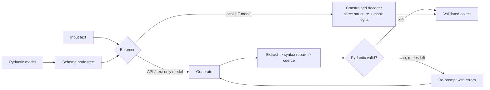

# structured-output-enforcer

Middleware that guarantees valid JSON / Pydantic output from an LLM. It uses **schema-constrained decoding** for local Hugging Face models (a custom JSON-schema decoder, CPU-friendly). For API models it uses a **validate-and-repair fallback** with error-feedback retries. It was measured on a committed 60-item test set: schema-valid rate with and without enforcement.

## What it is
- `soe.constrained.ConstrainedJSONDecoder`: walks the schema and masks the model's logits at every step. Each emitted prefix is a valid prefix of a schema-valid document.
- `soe.repair`: extract (from fences or prose), then syntax repair (trailing commas, single quotes, Python literals, unquoted keys, comments, unclosed brackets), then type coercion (`"5"` to `5`, `"Yes"` to `true`, scalar to list, enum case-folding, drop unknown keys). Pydantic validates the result.
- `soe.enforcer.Enforcer`: one call site. It uses `constrained` when logits are available. Otherwise it uses `repair` and then re-prompts with the validation errors (up to 2 retries).
- Supported schema subset: objects, arrays (`minItems`/`maxItems`), strings (`maxLength`), integers and numbers (small int ranges enforced exactly), booleans, enums/`Literal`, nested models. `Optional`/`anyOf` raises `UnsupportedSchema`.

## Why
Downstream code breaks on one bad bracket. Prompting with the schema works for capable models. It fails for small models, for long schemas you can't fit in the prompt, and for any model that sometimes adds prose. Constrained decoding removes the failure mode. Repair and retry recover most of it for models you can only call over an API.

## Architecture


## How it works
The decoder runs a schema walk over a KV-cached model:
- **Forced text:** braces, keys, `": "`, `", "` are tokenized and fed in one batched forward pass.
- **Strings:** only tokens without `"`, `\` or control characters, plus tokens that end in a closing quote. At each step the decoder *peeks*: if the model's best token starts with `"` (e.g. `",`), it closes the string.
- **Enums, booleans, small int ranges:** a greedy trie over the allowed literals.
- **Numbers:** digit tokens. A peek decides digit vs `.` vs terminator.
- **Arrays:** a peek decides "next item" vs `]`, within `minItems`/`maxItems`.

## Results
All numbers are measured, from `results/<model>[-minimal-prompt]/summary.json`. The setup is 60 **synthetic** extraction inputs (`data/testset.jsonl`, 5 schemas × 12, seeded), greedy decoding, CPU (M2 Pro). There are two prompt styles: **schema** puts the full JSON Schema in the system prompt; **minimal** lists only the field names.

Schema-valid outputs (out of 60):

| Model | Prompt | No enforcement | + repair | + repair + 2 retries | **Constrained** |
|---|---|---|---|---|---|
| Qwen2.5-0.5B-Instruct | schema | 60 | 60 | 60 | **60** |
| Qwen2.5-0.5B-Instruct | minimal | 0 | 24 | 50 | **60** |
| SmolLM2-135M-Instruct | schema | 0 | 0 | 1 | **60** |
| SmolLM2-135M-Instruct | minimal | 1 | 6 | 6 | **60** |

Field accuracy (exact match of leaf values against gold, invalid output = 0):

| Model | Prompt | No enforcement | + repair | + retries | Constrained |
|---|---|---|---|---|---|
| Qwen2.5-0.5B-Instruct | schema | 0.861 | 0.861 | 0.861 | 0.721 |
| Qwen2.5-0.5B-Instruct | minimal | 0.000 | 0.355 | 0.631 | 0.667 |
| SmolLM2-135M-Instruct | schema | 0.000 | 0.000 | 0.000 | 0.319 |
| SmolLM2-135M-Instruct | minimal | 0.008 | 0.038 | 0.038 | 0.446 |

Mean seconds per item, unconstrained vs constrained: 0.5B schema 4.50 vs 2.39; 135M schema 3.76 vs 0.82. Constrained decoding is faster here because forced structure tokens cost no sampling steps and the outputs are shorter.

**Honest reading:**
- When a capable model gets the full schema in the prompt (0.5B, schema), every condition was already 60/60 valid. Constrained decoding *lowered* field accuracy (0.861 to 0.721). The forced token boundaries and fixed key order differ from what the model would write.
- Enforcement pays off when the prompt or the model is weak. Constrained decoding stays 60/60 everywhere. Repair+retry reaches only 50/60 and 6/60 in those settings.

## Tests
36 tests (`pytest -q`):
- 14 cover repair, coercion, the enforcer retry loop and schema normalization.
- 20 are property tests. A **random-logits fake model** must still produce schema-valid output for every schema (5 schemas × 4 seeds).
- One test checks bounds, lengths and enum arrays.
- One runs a real SmolLM2-135M check through the KV-cache path.

## Run it
```bash
pip install -r requirements.txt
pytest -q
python -m eval.build_testset                      # regenerates data/testset.jsonl (already committed)
python -m eval.run_eval --model Qwen/Qwen2.5-0.5B-Instruct --prompt schema
python -m eval.run_eval --model HuggingFaceTB/SmolLM2-135M-Instruct --prompt minimal
```

## Limits
- The test inputs are synthetic and template-based (n = 60). Field accuracy on real documents will differ.
- The schema subset has no `Optional`/`anyOf`, `pattern`, `format`, or float ranges. Large integer ranges are post-validated, not enforced.
- The decoder is a Python loop with greedy decoding only. It is not batched and not as fast as Outlines/XGrammar-style compiled grammars.
- The repair fallback was evaluated with local models standing in for API models. No paid API was called.
- With a strong prompt and model, constrained decoding cost accuracy (above). Use it when validity matters more than the last few points.

## License
MIT
